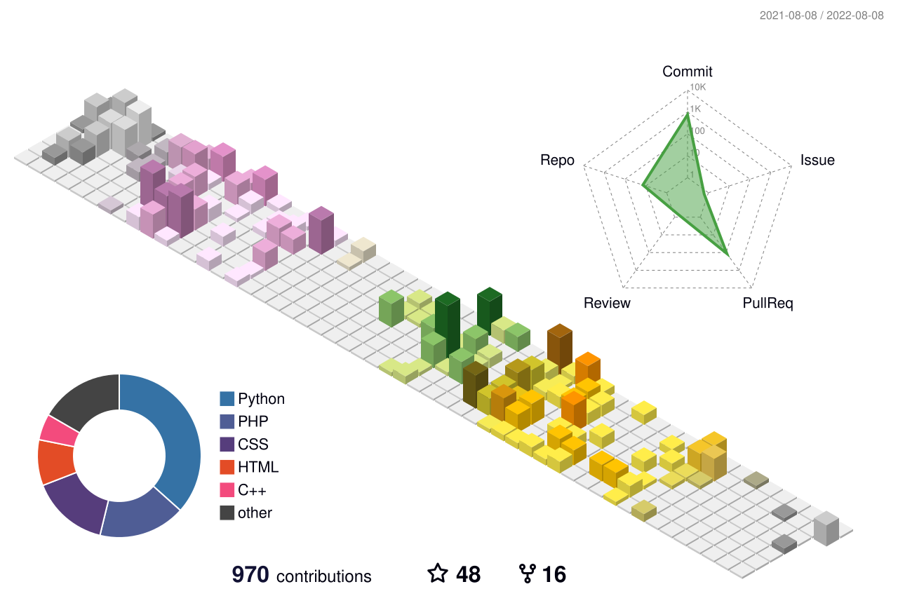
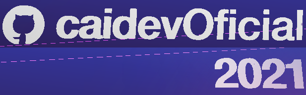
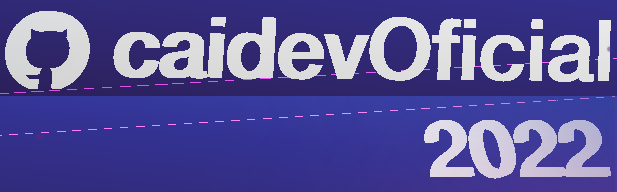

<div align="center">

  <!-- Header Avatar & Greeting -->
  <a href="https://github.com/CaidevOficial">
    
  </a>

  <h1>Hey there! I'm Facu Falcone 👋</h1>

  <!-- Dynamic Typing Subtitle -->
  <a href="https://caidevoficial.github.io/FF_Resume/">
    
  </a>

  <p>
    <b>Pisces ♓ &bull; Data Engineer &bull; Academic Instructor &bull; Lifelong Learner</b>
  </p>

  <!-- Quick Info Badges -->
  <p>
    <a href="https://www.accenture.com/">
      
    </a>
    <a href="https://www.frba.utn.edu.ar/">
      
    </a>
    <a href="https://github.com/caidevOficial/Yaguarete_Lang">
      
    </a>
    <a href="https://komarev.com/ghpvc/?username=caidevoficial">
      
    </a>
  </p>

  <!-- Connect & Social Buttons -->
  <p>
    <a href="https://linkedin.com/in/facundo-falcone" target="_blank">
      
    </a>
    <a href="https://caidevoficial.github.io/FF_Resume/" target="_blank">
      
    </a>
    <a href="https://cafecito.app/caidevoficial" target="_blank">
      
    </a>
    <a href="https://ko-fi.com/P5P74JBOH" target="_blank">
      
    </a>
  </p>

</div>

---

### 💫 About Me

```yaml
name: Facundo Falcone
nickname: Facu / caidevOficial
location: Buenos Aires, Argentina
current_roles:
  - Data Engineer at Accenture 👨‍💻
  - Python Professor & Data Sc. Student at Universidad de la Ciudad de Buenos Aires (UniCABA) 👨‍🏫
currently_exploring:
  - Advanced GCP Pipelines, BigQuery & Cloud Composer
focus_areas: [Data Engineering, Cloud Architecture, Scalable Backends, Education]
```

---

### 🐆 Featured Creation: YAGUARETÉ Language

<div align="center">
  <table border="0" width="100%">
    <tr>
      <td width="22%" align="center" valign="middle">
        <a href="https://github.com/caidevOficial/Yaguarete_Lang" target="_blank">
          
        </a>
      </td>
      <td width="78%" valign="middle">
        <h3>⚡ Creator & Lead Architect of <a href="https://github.com/caidevOficial/Yaguarete_Lang">YAGUARETÉ</a></h3>
        <p>
          A <b>strongly-typed Spanish pseudocode programming language</b> designed for modern algorithm learning, data structures, and software engineering, powered by an ultra-fast native Rust engine.
        </p>
        <p>
          <a href="https://github.com/caidevOficial/Yaguarete_Lang"></a>
          <a href="https://github.com/caidevOficial/Yaguarete_Lang"></a>
          <a href="https://github.com/caidevOficial/Yaguarete_Lang"></a>
          <a href="https://github.com/caidevOficial/Yaguarete_Lang#-extensi%C3%B3n-oficial-para-visual-studio-code"></a>
          <a href="https://github.com/caidevOficial/Yaguarete_Lang_Web"></a>
        </p>
      </td>
    </tr>
  </table>

  <!-- Pin cards for Yaguarete Core & Web -->
  <p>
    <a href="https://github.com/caidevOficial/Yaguarete_Lang">
      
    </a>
    <a href="https://github.com/caidevOficial/Yaguarete_Lang_Web">
      
    </a>
  </p>
</div>

---

### 🛠️ Tech Stack & Toolbox

<div align="center">

#### 🚀 Languages
<p>
  <a href="https://www.python.org" target="_blank"></a>&nbsp;&nbsp;
  <a href="https://www.java.com" target="_blank"></a>&nbsp;&nbsp;
  <a href="https://dotnet.microsoft.com/" target="_blank"></a>&nbsp;&nbsp;
  <a href="https://en.cppreference.com/w/c" target="_blank"></a>&nbsp;&nbsp;
  <a href="https://www.rust-lang.org/" target="_blank"></a>&nbsp;&nbsp;
  <a href="https://developer.mozilla.org/en-US/docs/Web/JavaScript" target="_blank"></a>&nbsp;&nbsp;
  <a href="https://www.php.net/" target="_blank"></a>&nbsp;&nbsp;
</p>

#### ☁️ Cloud & Big Data
<p>
  <a href="https://cloud.google.com/" target="_blank"></a>&nbsp;&nbsp;
  <a href="https://cloud.google.com/bigquery" target="_blank"></a>&nbsp;&nbsp;
  <a href="https://firebase.google.com/" target="_blank"></a>&nbsp;&nbsp;
  <a href="https://azure.microsoft.com/" target="_blank"></a>
</p>

#### 📚 Libraries & Frameworks
<p>
  <a href="https://pandas.pydata.org/" target="_blank"></a>&nbsp;&nbsp;
  <a href="https://numpy.org/" target="_blank"></a>&nbsp;&nbsp;
  <a href="https://matplotlib.org/" target="_blank"></a>&nbsp;&nbsp;
  <a href="https://djangoproject.com/" target="_blank"></a>&nbsp;&nbsp;
</p>

#### 🗄️ Databases & Storage
<p>
  <a href="https://www.mysql.com/" target="_blank"></a>&nbsp;&nbsp;
  <a href="https://mariadb.org/" target="_blank"></a>&nbsp;&nbsp;
  <a href="https://www.microsoft.com/sql-server/" target="_blank"></a>&nbsp;&nbsp;
  <a href="https://www.sqlite.org/" target="_blank"></a>
</p>

#### 🧰 Tools, Environments & Platforms
<p>
  <a href="https://git-scm.com/" target="_blank"></a>&nbsp;&nbsp;
  <a href="https://code.visualstudio.com/" target="_blank"></a>&nbsp;&nbsp;
  <a href="https://www.jetbrains.com/pycharm/" target="_blank"></a>&nbsp;&nbsp;
  <a href="https://www.eclipse.org/" target="_blank"></a>&nbsp;&nbsp;
  <a href="https://www.postman.com/" target="_blank"></a>&nbsp;&nbsp;
  <a href="https://insomnia.rest/" target="_blank"></a>&nbsp;&nbsp;
  <a href="https://tomcat.apache.org/" target="_blank"></a>&nbsp;&nbsp;
  <a href="https://www.arduino.cc/" target="_blank"></a>
</p>

#### 💻 Operating Systems & Productivity
<p>
  <a href="https://www.linux.org/" target="_blank"></a>&nbsp;&nbsp;
  <a href="https://ubuntu.com/" target="_blank"></a>&nbsp;&nbsp;
  <a href="https://www.debian.org/" target="_blank"></a>&nbsp;&nbsp;
  <a href="https://www.microsoft.com/windows" target="_blank"></a>&nbsp;&nbsp;
</p>

</div>

---

### 📊 GitHub Activity & Metrics

<div align="center">

  <!-- Overview Stats & Top Languages -->
  <p>
  <a href="https://github.com/CaidevOficial">
      
    </a>
    <a href="https://github.com/CaidevOficial">
      
    </a>
  </p>

  <!-- Streak Stats -->
  <p>
    <a href="https://github.com/CaidevOficial">
      
    </a>
  </p>

  <!-- Dev Joke Card -->
  <p>
    
  </p>

</div>

---

### 🧊 3D Contribution Graph

<div align="center">
  
</div>

<details>
  <summary><b>🗺️ View Skylines (2021 - 2022)</b></summary>
  <br>
  <div align="center">
    
    &nbsp;&nbsp;
    
  </div>
</details>

---

### 🗂️ Highlight Projects

<details open>
  <summary><b>🐍 Python Projects</b></summary>
  <br>
  <div align="center">
    <a href="https://github.com/caidevOficial/Python_Mini_DBZ_Game">
      
    </a>
    <a href="https://github.com/caidevOficial/Python_IEEE_Dec_Converter">
      
    </a>
    <a href="https://github.com/caidevOficial/Python_University_Countdown_Timer">
      
    </a>
    <br><br>
    <a href="https://github.com/caidevOficial/Python_RepositoryCloner">
      
    </a>
    <a href="https://github.com/caidevOficial/Python_MockDataGen">
      
    </a>
    <br><br>
    <a href="https://github.com/CaidevOficial/Python_StructureBuilder">
      
    </a>
    <a href="https://github.com/CaidevOficial/Python_CombinatorialCalculus">
      
    </a>
    <br><br>
    <a href="https://github.com/CaidevOficial/Python_Console_Pokemon_Game">
      
    </a>
    <a href="https://github.com/caidevOficial/Python_PBI_Script_Maker">
      
    </a>
    <br><br>
    <a href="https://github.com/CaidevOficial/Python_IEEE_Team14293">
      
    </a>
    <a href="https://github.com/caidevOficial/Python_ITBA_IEEE">
      
    </a>
    <br><br>
    <a href="https://github.com/CaidevOficial/Python_Udemy_DataManipulation">
      
    </a>
    <a href="https://github.com/CaidevOficial/Python_PoloTic_Fullstack">
      
    </a>
    <br><br>
    <a href="https://github.com/CaidevOficial/Python_Platzi">
      
    </a>
  </div>
</details>

<details>
  <summary><b>🔷 C# Projects</b></summary>
  <br>
  <div align="center">
    <a href="https://github.com/CaidevOficial/CSharp_StructureBuilder">
      
    </a>
    <a href="https://github.com/CaidevOficial/CSharp_UTN_LaboII">
      
    </a>
    <br><br>
    <a href="https://github.com/caidevOficial/CSharp_AccountControl">
      
    </a>
  </div>
</details>

<details>
  <summary><b>☕ Java Projects</b></summary>
  <br>
  <div align="center">
    <a href="https://github.com/CaidevOficial/Java_StructureBuilder_forC">
      
    </a>
    <a href="https://github.com/CaidevOficial/Java_PoloTic_Fullstack">
      
    </a>
    <br><br>
    <a href="https://github.com/CaidevOficial/Java_BMI_Calculator">
      
    </a>
    <a href="https://github.com/CaidevOficial/Java_CUV">
      
    </a>
  </div>
</details>

<details>
  <summary><b>⚡ C Projects</b></summary>
  <br>
  <div align="center">
    <a href="https://github.com/caidevOficial/C_CuadraticApp">
      
    </a>
    <a href="https://github.com/caidevOficial/C_CaiShen_Lin">
      
    </a>
    <br><br>
    <a href="https://github.com/caidevOficial/C_CaiShen_Win">
      
    </a>
    <a href="https://github.com/caidevOficial/C_Labo1_Progra1/tree/master/2_Trabajos_Practicos/TP4_FacuFalcone_LinkedList_%5BSaintSeiya_Linux%5D">
      
    </a>
  </div>
</details>

<details>
  <summary><b>🌐 Front-End Projects</b></summary>
  <br>
  <div align="center">
    <a href="https://github.com/caidevOficial/Front_TaiWeb">
      
    </a>
    <a href="https://github.com/caidevOficial/Front_CuadraticApp">
      
    </a>
    <br><br>
    <a href="https://github.com/caidevOficial/Front_UTN_LaboIII">
      
    </a>
    <a href="https://github.com/caidevOficial/Front_UTN_LaboIV">
      
    </a>
  </div>
</details>

<details>
  <summary><b>🐘 PHP Projects</b></summary>
  <br>
  <div align="center">
    <a href="https://github.com/caidevOficial/Php_UTN_PrograIII">
      
    </a>
  </div>
</details>

<details>
  <summary><b>💾 Database Projects</b></summary>
  <br>
  <div align="center">
    <a href="https://github.com/caidevOficial/SQL_EasyCode">
      
    </a>
    <a href="https://github.com/caidevOficial/SQL_UTN_BBDD">
      
    </a>
  </div>
</details>

---

### 🐍 Contribution Activity Stream

<div align="center">
  <picture>
    <source media="(prefers-color-scheme: dark)" srcset="https://raw.githubusercontent.com/caidevOficial/caidevOficial/output/github-snake-dark.svg" />
    <source media="(prefers-color-scheme: light)" srcset="https://raw.githubusercontent.com/caidevOficial/caidevOficial/output/github-snake.svg" />
    
  </picture>
</div>

---

<!-- Modern Footer -->
<div align="center">

  <a href="https://github.com/CaidevOficial">
    
  </a>

  <h4>Facundo Falcone</h4>
  <p>Data Engineer &bull; Python Professor &bull; Tech Community Enthusiast</p>

  <p>
    <a href="https://github.com/caidevOficial/">
      
    </a>
    <a href="https://www.linkedin.com/in/facundo-falcone/">
      
    </a>
    <a href="https://caidevoficial.github.io/FF_Resume/">
      
    </a>
    <a href="https://cafecito.app/caidevoficial/">
      
    </a>
    <a href="https://ko-fi.com/P5P74JBOH">
      
    </a>
  </p>

  <p><sub>⚡ Designed with care &bull; Powered by Python, GitHub Actions & Open Source ⚡</sub></p>

</div>